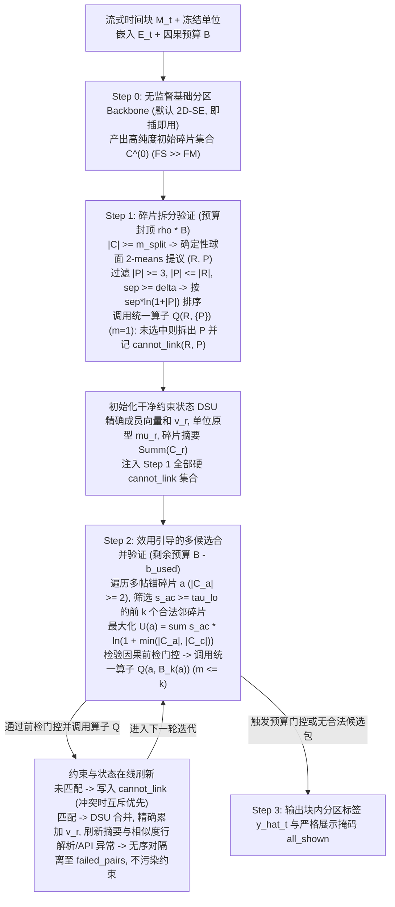

# FRAG-SED：面向预算受限流式社交事件检测的簇碎片级选择性大语言模型验证——论文方法与实验设计定稿

> **文档性质与事实边界声明**：本文档为面向 *Information Processing & Management*（IP&M）或同等顶会 IR/NLP 期刊/会议的完整论文设计与方法规格书，系统定义精简化后的核心方法 **`FRAG-SED`**（由工作区既有 `SUG-SED v2.0/v2.1` 演进重构而来）及其可审计实验协议。文中凡涉及已观测数值之处，均严格标注其出处为先导诊断实验（`SUG-SED v2.0` 留出集 27 块或 `SUG-SED v2.1` Dev 4 块）或原始数据集磁盘统计；**所有针对新版 `FRAG-SED` 的正式实验结果均尚未执行，文中绝不编造任何未运行的实验分数**。

---

## 1. 题目

- **推荐英文题目**：**Fragment-Level Selective LLM Verification for Budget-Constrained Streaming Social Event Detection**
- **推荐中文题目**：**面向预算受限流式社交事件检测的簇碎片级选择性大语言模型验证方法**
- **方法简称**：**`FRAG-SED`**（**Frag**ment-Level Selective LLM Verification for **S**ocial **E**vent **D**etection）

**定位说明**：
1. **聚焦单一核心贡献**：题目直接锚定本文唯一的方法论主轴——在严格流式 Token 预算约束下，将大语言模型（LLM）的查询粒度从单帖/单边对提升至“簇碎片（cluster fragment）”，并通过统一的多候选选择算子协同完成碎片拆分与合并验证，避免在标题中堆砌外围工程模块。
2. **契合顶刊审稿预期**：题目同时对接流式社交事件检测（Streaming SED）与预算受限 LLM 文本聚类两大脉络，突出“预算受限（Budget-Constrained）”与“选择性验证（Selective Verification）”的实用问题边界，符合 IP&M 等期刊对问题清晰、方法简洁、成本可审计的审美标准。

---

## 2. 摘要

流式社交事件检测（Streaming Social Event Detection, SED）旨在事件数量未知且词汇持续漂移的社交媒体实时流中，按时间块自动发现并聚类突发社会事件。尽管基于图结构熵的无监督方法（如 HISEvent）无需标注训练即可获得高纯度初始划分，但受限于表层词面与冻结句向量的表达瓶颈，极易将同一真实事件过度切分为多个碎片；另一方面，近期基于大语言模型（LLM）的事件检测与受限文本聚类方法大多工作在帖子或边对粒度，在严格的逐块因果 Token 预算约束下难以扩展。在本文的先导诊断审计（基于既有 `SUG-SED v2.0` 留出集 27 个时间块与 `v2.1` Dev 块）中，我们量化揭示了两项关键现象：其一，无监督二维结构熵（2D-SE）初始分区存在极端的成对误差非对称性，假分裂（False Splits, $\text{FS}$）远超假合并（False Merges, $\text{FM}$），在英文 `Event2012` 与法文 `Event2018` 留出集上 $\text{FS}/\text{FM}$ 比值分别高达 **$63.47\times$** 与 **$12.23\times$**；其二，在每块 `10,000` tokens 的严格零前瞻预算下，既有帖子级/边对级 LLM 基线（包括预算适配的 `LSED`、`RagSEDE`、`LHG`、`Few-Shot LLM-Post` 与 `Cequel-Edge`）相对 2D-SE 基础分区几乎陷入停滞，根源在于单次调用仅能修正 $O(1)$ 或 $|C_{\text{target}}|$ 级成对关系。

受此诊断启发并承袭超实例主动约束聚类（COBRA/COBRAS）的思想脉络，本文提出一种简洁、无需微调、底座无关的簇碎片级选择性 LLM 验证框架——**`FRAG-SED`**。该框架将 LLM 裁决单元由单帖提升至基础分区产生的高纯度簇碎片，使单次确认合并的成对修复收益从 $|C_{\text{target}}|$ 跃升至乘性杠杆 $a \cdot b$，并以**仅 3 个块内步骤、1 个统一多候选选择算子 $\mathcal{Q}$ 与 6 个核心超参数**构成闭环：首先，以即插即用的无监督结构熵分区（Step 0）产出高纯度初始碎片；其次，在不超过 $\rho B$ 的预算封顶内，采用确定性球面 2-means 与语义分离度门控生成少数口袋候选，调用 $\mathcal{Q}(R, \{P\})$ 清洗混杂大簇并写入硬互斥（`cannot_link`）约束（Step 1）；随后，在剩余预算内基于仅传播互斥约束与精确在线原型和的干净并查集，按预期成对收益效用迭代选取多帖锚碎片及其前 $k$ 个相似邻碎片，通过同一算子 $\mathcal{Q}(a, \{c_1, \dots, c_m\})$ 摊销提示词开销并在线更新碎片摘要与互斥状态（Step 2）。为严谨检验所提方法，本文进一步设计了零前瞻因果预算门控、四组系统对比基线（涵盖 0-LLM SED、预算适配与原生无约束 LLM-SED、含 `COBRAS+LLM` 在内的主动约束聚类以及内部诊断对照）、标准聚类指标（NMI/AMI/ARI 与微/宏平均 $B^3$）、未展示子集防泄漏指标（`Unseen-Subset AMI`）及端到端脱敏抗记忆审计协议。文中先导诊断证据均来自已落盘的 `v2.0/v2.1` 历史快照，精简化 `FRAG-SED` 的完整基准评测与 `protocol_v3.json` 协议冻结将按本文第 8.4 节路线图推进执行。

---

## 3. 介绍

社交媒体流以高并发、短文本、多语噪声与非平稳话题演化为典型特征。流式社交事件检测（Streaming Social Event Detection, SED）要求系统在每个离散时间块 $M_t$ 到达时，在**未知真实事件数 $K_t^*$**、且无法预知未来消息流的前提下，将属于同一现实世界事件的帖子聚为一类（Allan et al., 1998b; Cao et al., 2021）。长期以来，该领域面临两难困境：

1. **无监督图/结构熵方法的“过碎片化”瓶颈**：以 HISEvent（Cao et al., 2024）和 HyperSED（Yu et al., 2025）为代表的无监督方法摆脱了对监督图神经网络（如 KPGNN、QSGNN、FinEvent）中大规模标注样本的依赖，能够在零训练开销下快速输出高纯度事件簇。然而，当同一突发事件在不同报道角度、俚语、缩写或跨语种表述下缺乏表层共现词与高余弦句向量相似性时，无监督图划分必然将其割裂为大量互不相连的子簇碎片。
2. **大语言模型方法的“预算失配”瓶颈**：大语言模型凭借强大的世界语义与事件推理能力，理论上能够跨越词汇鸿沟识别同事件碎片。然而，现有 LLM 增强 SED 工作——例如逐帖改写增强的 LSED（Qiu et al., 2025）、面向初始消息生成伪标签的 LHG（Qiu et al., 2026）以及基于检索增强知识库的 RagSEDE（Liu et al., 2026）——在默认范式下均未受限于严格的逐块 Token 预算，面对日均数千条帖子的流式窗口时推理成本高昂；而通用预算受限 LLM 文本聚类方法（如 ClusterLLM、Few-Shot LLM Clustering、Cequel）则普遍将查询作用在单帖、文档对或三元组粒度上。

### 3.1 先导诊断发现：$\text{FS} \gg \text{FM}$ 结构非对称性与帖子级预算失效

为厘清轻量开源 LLM（如 `Qwen/Qwen3-8B`）在严格逐块预算（例如每块 $B = 10{,}000$ tokens，折合仅约 $2\text{--}5$ tokens/帖）下为何难以奏效，我们对工作区既有的先导诊断实验（`SUG-SED v2.0` 在 `Event2012` 16 块与 `Event2018` 11 块共 27 个留出块上的全量评测，以及 `v2.1` 在 `M_02..M_05` Dev 块上的对照审计）进行了成对误差与基线行为剖析，得到两项高度一致的实证发现：

- **发现一（极端的 $\text{FS} \gg \text{FM}$ 误差非对称性）**：在 `v2.0` 留出集上，高纯度二维结构熵基础分区 `Pure 2D-SE (0.50)` 的成对误差高度偏斜——在 `Event2012`（16 块，`32,695` 帖）上共产生 **`6,096,628`** 对假分裂（$\text{FS}$），而假合并（$\text{FM}$）仅 **`96,059`** 对，比值高达 **$63.47\times$**；在法语 `Event2018`（11 块，`33,161` 帖）上为 $\text{FS} = 5{,}161{,}372$ 对 vs $\text{FM} = 421{,}974$ 对，比值仍达 **$12.23\times$**（即便采用更宽松阈值的 `HISEvent Default (0.35)`，二者比值亦分别达 **$44.64\times$** 与 **$11.59\times$**）。这意味着无监督基础分区已解决绝大部分局部去噪与初始聚集工作，主要剩余误差集中在“同事件碎片间的假分裂”，辅以少量高破坏性的“混杂大簇内假合并”。
- **发现二（严格预算下帖子级/边对级 LLM 细化全面停滞）**：在同等 `10,000` tokens/块的零前瞻因果预算下，`v2.0` 留出集数据显示，所有作用于帖子或边对粒度的 LLM 基线相对 `Pure 2D-SE Base` 几乎无实质增益：在 `Event2012`（Base AMI `83.98`）上，`Few-Shot LLM-Post` 仅 `83.98`、`LSED-Budgeted` 仅 `84.09`、`RagSEDE-Budgeted` 仅 `83.99`、`LHG-Budgeted` 降至 `83.56`、`Cequel-Edge` 降至 `83.90`；在 `Event2018`（Base AMI `75.68`）上，上述五者分别为 `75.78`、`75.81`、`75.69`、`75.17` 与 `75.67`（该现象在 `v2.0/v2.1` Dev 块 `M_02..M_05` 上亦一致复现）。进一步地，`v2.0` 留出集三因子归因表明，仅将查询架构从帖子级 `Random` 切换至 `v2.0` 介观架构随机序对照 `Random-Meso`，即可在 27 个留出块上带来 **$\Delta\text{AMI} = +5.80$**（$p_{\text{raw}} = 1.49 \times 10^{-8}$）与 **$\Delta\text{Mic-}B^3 = +10.52$** 的主体跃升；而五支柱消融进一步暴露出早期系统中的 `AutoMerge`、`Two-Tier Band`、`GuardedUF` 质心下界与跨天 LLM 裁决均属高复杂度低收益甚至跨语脆弱组件，真正驱动性能的核心正是**簇碎片级多候选合并验证**与**针对性混杂碎片拆分验证**。

### 3.2 核心洞见：从帖子到簇碎片的乘性收益杠杆

为什么预算相同时，提升查询粒度会产生量级差异？考虑一条孤立帖子 $x$ 被 LLM 重分配至规模为 $|C_{\text{target}}|$ 的目标簇：单次正确判断最多只能修复 $|C_{\text{target}}|$ 对关系；若采用文档对查询（如 `Cequel-Edge`），单次调用仅直接决定 $1$ 对关系。相反，当基础分区已经提供高纯度簇碎片 $C_a$（规模 $a = |C_a|$）与 $C_c$（规模 $b = |C_c|$）时：

1. **合并验证的乘性杠杆（$a \cdot b$ vs $|C_{\text{target}}|$）**：LLM 对紧凑碎片摘要进行一次正向确认并合并 $(C_a, C_c)$，即可一次性修复 **$a \cdot b$** 对假分裂关系（例如合并两个各含 20 条帖子的同事件碎片可瞬时消除 $400$ 对 $\text{FS}$ 误差，而非单帖操作的 $20$ 对）；
2. **多候选打包的提示词摊销**：将 $1$ 个锚碎片与至多 $k$ 个活跃邻碎片打包送入同一选择算子 $\mathcal{Q}(a, \{c_1, \dots, c_m\})$，既把固定系统指令与锚点上下文摊销至 $m$ 次比较，又为模型提供了跨候选的横向对比语境（Wang et al., COLING 2025）；
3. **先拆后合的硬互斥保护**：对少数内部发生语义撕裂的大碎片 $(R, P)$ 执行一次拆分验证 $\mathcal{Q}(R, \{P\})$，不仅可一次性消除 $|R| \cdot |P|$ 对假合并误差，还通过写入永久 `cannot_link` 约束防止后续合并阶段将其静默合回。

基于上述洞见，我们将既有庞杂的五阶段流水线大刀阔斧地精简重构为 **`FRAG-SED`**——一个仅含 **3 个块内步骤、1 个统一多候选选择算子 $\mathcal{Q}$、6 个核心超参数**的干净框架。

### 3.3 主要贡献

本文的核心贡献可凝练为以下三点：

1. **流式 SED 误差结构与预算失效的实证诊断**：首次在双语流式社交事件基准上系统量化了无监督 2D-SE 划分的极端 $\text{FS} \gg \text{FM}$ 非对称性，并结合成对收益分析与 `v2.0/v2.1` 先导实证揭示了帖子级/边对级 LLM 方法在严格因果 Token 预算下失效的根本机理。
2. **统一简洁的簇碎片级选择性验证框架（`FRAG-SED`）**：在明确承袭 COBRA/COBRAS 超实例约束聚类谱系的基础上，面向未知 $K_t^*$ 流式 SED、含噪开源 LLM 与严格 Token 预算，提出免微调、底座即插即用的三步框架 `FRAG-SED`：以单一 $k$-way JSON 选择算子 $\mathcal{Q}$ 统一预算封顶的球面 2-means 碎片拆分验证与效用引导的多候选碎片合并验证，并依托仅维护精确原型和与 `cannot_link` 传播的干净并查集实现高性价比纠错与错误隔离。
3. **严格零前瞻因果预算与防泄漏可审计评测协议**：构建面向流式预算受限 LLM-SED 的可复现评测方案，涵盖统一零前瞻逐块预算门控与真实计费账本、含 `COBRAS+LLM` 与原生无约束参照在内的四组基线矩阵、标准 `NMI/AMI/ARI` 与微/宏平均 $B^3$ 双轨指标、严格剔除展示样本的 `Unseen-Subset AMI` 防泄漏审计以及端到端编码前脱敏抗记忆检验。

---

## 4. 相关工作

本节围绕与 `FRAG-SED` 最紧密的四条研究脉络梳理已有工作，并在第 4.5 节以结构化对比表精确界定本文的新颖性边界。

### 4.1 传统流式、图神经网络与结构熵社交事件检测

早期事件检测源起于话题检测与追踪（Topic Detection and Tracking, TDT）任务，涵盖广播与新闻流中的分割、新事件发现与追踪（Allan et al., 1998a），并确立了严格无前瞻的单遍在线聚类（Allan et al., 1998b）以及回顾式与在线式检测的系统对比范式（Yang et al., 1998）。面对 Twitter 级别的实时短文本流，Petrović et al.（HLT-NAACL 2010）引入局部敏感哈希（LSH）加速实时首帖检测；此后，McMinn et al.（CIKM 2013）与 Mazoyer et al.（LREC 2020）分别构建了英文 `Event2012` 与法文 `Event2018` 大规模推特评测语料（其中 Mazoyer et al. 亦指出在无监督事件检测中，TF-IDF 往往优于早期神经句向量表示）。在表示学习与社区发现层面，Sentence-BERT（Reimers & Gurevych, EMNLP-IJCNLP 2019）提供了高效的稠密语义句向量以支撑余弦凝聚聚类，而 EventX / Story Forest（Liu et al., ACM TKDD 2020）则采用双层关键词社区图聚类与在线故事树追踪事件演进。

随着图神经网络（GNN）兴起，KPGNN（Cao et al., WWW 2021）将社交消息、词元、实体与用户建模为异构图，结合对比学习与周期性节点清理实现增量检测，并确立了以首周为 $M_0$、后续按天切分为 $M_1 \dots M_{21}$（Event2012）或 $M_1 \dots M_{16}$（Event2018）并以 **NMI、AMI、ARI** 评测的增量 SED 标准协议。后续工作如 QSGNN（Ren et al., ACM CIKM 2022）利用参考相似度分布生成并加权筛选开放集伪成对标签，FinEvent（Peng et al., IEEE TPAMI 2023 [Early Access 2022]）引入多智能体强化学习指导的多关系异构图神经网络与平衡对比学习。然而，GNN 类方法普遍依赖带标签训练块且在开放域新事件涌现时存在迁移退化。

为消除标注依赖并适配未知事件数 $K_t^*$，无监督结构熵与双曲空间方法成为近年主流：HISEvent（Cao et al., AAAI 2024）通过增量一维结构熵边补全与层次二维结构熵（2D-SE）图划分实现完全无监督未知 $K$ 检测；ADP-SEMEvent（Yang et al., ACM CIKM 2024）在自适应差分隐私消息图上引入最优子图 2D-SE 聚类；HyperSED（Yu et al., AAAI 2025）提出语义消息锚图（SAMG）与双曲空间可微结构划分树，相对既有无监督图基线取得 $12\times\text{--}37\times$ 的加速。尽管这类 0-token 方法高效且簇纯度高，但其仅依赖静态表层属性与嵌入几何，难以弥合语义改写鸿沟，导致显著的 $\text{FS} \gg \text{FM}$ 过碎片化。`FRAG-SED` 将此类无监督划分器视为即插即用的 Step 0 底座，专注以极低 Token 代价选择性修复其残余碎片误差。

### 4.2 大语言模型增强社交事件检测

近期研究开始探索将大语言模型引入流式社交事件检测。LSED（Qiu et al., ACL 2025）完全摒弃图神经网络，使用开源 LLM（如 Llama 3.1 / Qwen 2.5）对**每一条到达的帖子**进行规范化、消歧与摘要改写，再将改写文本嵌入双曲空间执行增量聚类；该方法虽展示了 LLM 强大的语义对齐能力，但逐帖推理使 LLM 开销成为绝对瓶颈，缺乏严格的逐块预算上限。LHG（Qiu et al., WWW 2026）利用 LLM 为初始社交消息生成伪标签，随后在异构信息图上通过元路径引导的标签相似度选择器（MPLSS）过滤幻觉并学习双曲图表示，其 LLM 调用仍集中在单条消息层面。RagSEDE（Liu et al., WWW 2026）结合代表性与多样性采样、检索增强（RAG）演化事件知识库与结构熵实现无监督事件检测与演化，但并未围绕严格零前瞻逐块 Token 预算或碎片级拆分/合并联合验证进行设计。当系统被置于例如 `10,000` tokens/块的紧预算约束下时，逐帖增强范式仅能覆盖流中极小比例帖子，而 `FRAG-SED` 将全部预算精准投放至高成对收益的簇碎片验证上。

### 4.3 预算受限大语言模型聚类与主动约束聚类

将成对约束引入聚类始于 COP-KMeans（Wagstaff et al., ICML 2001）提出的实例级 must-link 与 cannot-link 约束。**与本文算法谱系最为直接相关的是超实例（super-instance）主动约束聚类系列**：COBRA（Van Craenendonck et al., IJCAI 2017）首先用 $k$-means 将数据过度聚类为 $k_{\text{init}}$ 个超实例，再对超实例中心点（medoids）发起二元成对查询并借助传递闭包与约束蕴含进行合并；COBRAS（Van Craenendonck et al., IDA 2018）进一步消除了 $k_{\text{init}}$ 依赖，从覆盖全数据集的单个超实例自顶向下出发，迭代选取**规模最大**的超实例以 2-means 二分，通过二元查询检验纯度后再执行 COBRA 合并。本文明确承袭 COBRA/COBRAS 在介观超实例上联合执行拆分与合并的思想（绝不宣称“首次在微簇/超实例上做约束聚类”），但在三个关键维度存在本质差异：（1）**初始化与 $\text{FS} \gg \text{FM}$ 对齐**：流式日常事件块含数十至上百个细粒度事件，COBRAS 自顶向下反复切分最大簇会浪费大量查询，而 `FRAG-SED` 从无监督 2D-SE 高纯度碎片出发，以语义分离度排序且将拆分预算封顶于 $\rho B$，将主体预算聚焦于占主导的假分裂合并；（2）**含噪 LLM 下的 $k$-way 多候选选择与 Token 预算**：COBRA/COBRAS 假设无噪神谕（oracle）按“查询次数”回答单中心二元（$m=1$）问题，而 `FRAG-SED` 在严格因果 Token 预算 $B$ 与含噪开源 LLM 条件下，采用多信号紧凑碎片摘要（规模 + 2 条代表帖 + 5 个关键词）与统一 $k$-way 选择算子 $\mathcal{Q}$ 实现提示词摊销与解析错误隔离；（3）**成对收益效用调度**：以 $U(a) = \sum_c s_{ac}\ln(1+\min(|C_a|,|C_c|))$ 替代最大簇或最近中心启发式。

在 LLM 引导文本聚类领域，ClusterLLM（Zhang et al., EMNLP 2023）查询 LLM 标注难例文档三元组以对比微调小嵌入器，并在层次聚类树上执行成对粒度校准；Few-Shot LLM Clustering（Viswanathan et al., TACL 2024）通过关键词扩展、成对约束生成与聚类后纠错放大少样本专家先验；LLMEdgeRefine（Feng et al., EMNLP 2024）虽在 K-means 中构建超点（super-points）以抵御离群点对质心的干扰，但 LLM 查询对象仍聚焦于单个模糊**边界点**的归属重分配；Cequel（Wang et al., ACM CIKM 2025）在查询预算下利用贪心生成树边/三角形中心性挑选信息量最高的文档对（`EdgeLLM`）或三元组（`TriangleLLM`），构造约束并指导 PMI 加权约束聚类。上述方法要么依赖嵌入器微调，要么面向静态已知 $K$ 场景，且查询单元均停留在单帖/文档对级别（单次调用仅解析 $O(1)$ 成对关系）；`FRAG-SED` 则完全免微调，直接服务于未知 $K_t^*$ 的流式时间块，在簇碎片粒度上实现乘性收益放大。

### 4.4 多候选大语言模型选择、批处理与成本控制

面向大语言模型的成本优化与多候选提示设计已在实体解析（Entity Resolution, ER）与通用推理路由领域展现出显著威力。Wang et al.（COLING 2025）在实体匹配任务中系统比较了二元匹配（*Matching*）、成对比较（*Comparing*）与多候选选择（*Selecting*），实证发现多候选选择凭借候选间横向比较语境与调用次数缩减同时提升了准确率与效率，并提出复合框架 ComEM。Fan et al.（IEEE ICDE 2024）提出 BATCHER，通过批处理提示与上下文示范选择探索低成本 LLM 实体解析设计空间。更早的众包连接研究（Wang et al., ACM SIGMOD 2013）则系统利用匹配传递性与标注顺序启发式最小化人工查询开销；FrugalGPT（Chen et al., TMLR 2024）从提示词适配、近似替代与模型级联角度总结了降低 LLM 推理成本的通用机制。与上述面向静态记录表二元连接或通用问答路由的工作不同，`FRAG-SED` 将多候选选择、传递合并与硬互斥传播有机迁移至**未知 $K_t^*$ 的动态流式事件碎片聚类**，并与预算封顶的口袋拆分验证及零前瞻因果 Token 前检门控深度整合。

### 4.5 与最相近工作的结构化对比

| 方法（出处） | 流式未知 $K_t^*$ | 免微调（Training-Free） | LLM / Oracle 查询粒度 | 查询算子形态 | 拆分 + 合并协同 | 严格因果 Token 预算门控 | 含噪错误隔离与硬互斥 DSU |
|---|---|---|---|---|---|---|---|
| **HISEvent**（AAAI 2024） | 是 | 是 | 无（0-LLM） | — | 仅 2D-SE 图划分 | 不适用（0 Token） | 无 |
| **HyperSED**（AAAI 2025） | 是 | 是 | 无（0-LLM） | — | 仅双曲结构划分树 | 不适用（0 Token） | 无 |
| **LSED**（ACL 2025） | 是 | 是（冻结 LLM） | 单条帖子（全量改写） | 单帖文本增强 | 无 | 否（无界逐帖开销） | 无 |
| **RagSEDE**（WWW 2026） | 是 | 是（RAG+SE） | 采样消息 + 知识库检索 | RAG 增强 + 2D-SE | 无显式碎片拆分验证 | 否（无严格逐块预算门控） | 无 |
| **COBRA / COBRAS**（IJCAI'17 / IDA'18） | 否（静态聚类） | 是 | 超实例（单中心代表） | 二元成对（$m=1$） | 是（COBRAS 自顶向下二分 + 合并） | 否（按查询次数，假设无噪神谕） | 传递闭包（无 LLM 噪声隔离） |
| **ClusterLLM**（EMNLP 2023） | 否（静态聚类） | 否（微调嵌入器） | 文档三元组 + 层次节点对 | 三元组 + 二元对 | 仅粒度切分/聚合 | 否（按查询次数） | 无 |
| **Cequel**（CIKM 2025） | 否（静态固定 $K$） | 是 | 文档对 / 文档三元组 | `EdgeLLM` / `TriangleLLM` | 依赖约束聚类器 | 否（按查询次数） | 软/硬边约束 |
| **ComEM**（COLING 2025） | 否（静态 ER） | 是 | 单条实体记录 | 多候选选择（*Select*） | 仅实体匹配连接 | 否（成本优化，非流式因果桶） | 无 |
| **`FRAG-SED`（本文）** | **是** | **是** | **高纯度簇碎片（多信号摘要）** | **统一 $k$-way 选择算子 $\mathcal{Q}$** | **是（$\rho B$ 封顶球面拆分 + 效用合并）** | **是（零前瞻前检 + 真实账本）** | **是（错误隔离 + 互斥优先 DSU）** |

---

## 5. 问题定义

为保证后文方法、伪代码与实验协议的符号完全一致，本节给出预算受限流式社交事件检测的形式化定义。

### 5.1 流式时间块与冻结表示

考虑按时间先后顺序到达的离散社交媒体消息流块序列 $\{M_0, M_1, \dots, M_T\}$。遵循增量 SED 基准切分规则（Cao et al., 2021），初始块 $M_0$ 聚合首周（前 7 个自然日）消息，此后每个块 $M_t$（$t \ge 1$）对应单个自然日（若尾部某日消息数少于 $200$ 条，则并入相邻块以防退化单日块）。在任意待处理块 $M_t$ 中，共有 $N_t = |M_t|$ 条按时间戳与消息 ID 升序排列的帖子 $\{1, \dots, N_t\}$。每条帖子 $i$ 包含：
- 原始文本 $x_i$ 与发布时间戳 $\mathrm{ts}_i \in \mathbb{R} \cup \{\mathrm{NaN}\}$；
- 轻量结构化元属性：归一化命名实体集合 $E_i$、话题标签集合 $H_i$、作者用户标识 $u_i$、提及用户集合 $U_i$ 及词形还原词元表 $L_i$；
- 由冻结预训练句向量编码器 $\phi(\cdot)$ 提取并经严格单位 $L_2$ 归一化的稠密语义向量 $\mathbf{e}_i = \phi(x_i) / \|\phi(x_i)\|_2 \in \mathbb{S}^{d-1}$，构成嵌入矩阵 $\mathbf{E}_t \in \mathbb{R}^{N_t \times d}$（本文 $d = 384$，全程冻结不微调）。

### 5.2 块内未知事件数聚类目标

设时间块 $M_t$ 存在未知的真实事件划分 $\mathcal{Y}_t^* = \{Y_1^*, \dots, Y_{K_t^*}^*\}$（等价于真实标签向量 $\mathbf{y}_t^* \in \{1, \dots, K_t^*\}^{N_t}$），其中真实事件数 $K_t^*$ **预先未知**且随时间剧烈波动。流式块内事件检测的目标是在仅可见历史与当前块 $M_t$ 的严格因果约束下，输出块内划分 $\hat{\mathcal{P}}_t = \{\hat{C}_1, \dots, \hat{C}_{\hat{K}_t}\}$（等价于标签向量 $\hat{\mathbf{y}}_t \in \{1, \dots, \hat{K}_t\}^{N_t}$），最大化 $\hat{\mathcal{P}}_t$ 与 $\mathcal{Y}_t^*$ 的外部聚类一致性（以 NMI、AMI、ARI 及微/事件宏平均 $B^3$ 衡量）。

### 5.3 严格零前瞻因果 Token 预算约束

给定面向单个时间块的统一 LLM Token 预算上限 $B \in \mathbb{Z}_{>0}$（主实验 $B = 10{,}000$，**禁止跨块结转** `allow_carryover=False`），系统严格禁止窥探未来时间块 $\{M_{t+1}, \dots, M_T\}$ 的块数或消息规模以重新分配预算。

令 $b_{\text{used}}$ 表示当前块 $M_t$ 内已经实际消耗的累计 Token 数（初始为 $0$）。对于任一待发送的 LLM 查询 $q = (\text{sys}, \text{usr})$，系统在发起网络请求前必须通过**因果前检门控（Preflight Gate）**检验：
$$b_{\text{used}} + \hat{b}(q) \le B, \qquad \hat{b}(q) = \left\lfloor \frac{|\text{sys}| + |\text{usr}|}{3.4} \right\rfloor + b_{\text{comp}}$$
其中 $|\text{sys}|, |\text{usr}|$ 为系统提示与用户提示字符长度，$3.4$ 为保守字符/Token 换算常数，$b_{\text{comp}}$ 为紧凑 JSON 输出的预留补全 Token 估算值（输出硬上限 `max_tokens=384`）。门控拒绝时立即停止对应阶段调用；调用执行后，严格按照 API 返回的真实计费总额（`prompt_tokens + completion_tokens`，仅当服务端缺失 `usage` 字段时按字符数除以 $3.4$ 兜底并显式标记 `USAGE_MISSING`）累加更新 $b_{\text{used}}$，写入只追加审计账本 `TokenLedger`（即使命中本地确定性缓存，仍按同等真实 Token 扣减，严禁以缓存规避预算）。

### 5.4 精确成对误差分解：假分裂（FS）与假合并（FM）

在时间块 $M_t$ 的全部无序帖子对集合 $\Omega_t = \{\{i, j\} : 1 \le i < j \le N_t\}$（共 $\binom{N_t}{2}$ 对）上，任意预测划分 $\hat{\mathbf{y}}_t$ 相对真实划分 $\mathbf{y}_t^*$ 的成对判定误差可精确分解为假分裂（False Splits, $\text{FS}$）与假合并（False Merges, $\text{FM}$）两项：
$$\text{FS}(\hat{\mathbf{y}}_t, \mathbf{y}_t^*) = \Bigl|\bigl\{\{i, j\} \in \Omega_t : y_i^* = y_j^* \;\land\; \hat{y}_i \neq \hat{y}_j\bigr\}\Bigr|$$
$$\text{FM}(\hat{\mathbf{y}}_t, \mathbf{y}_t^*) = \Bigl|\bigl\{\{i, j\} \in \Omega_t : y_i^* \neq y_j^* \;\land\; \hat{y}_i = \hat{y}_j\bigr\}\Bigr|$$
定义结构误差非对称比 $\gamma_t = \text{FS}(\hat{\mathbf{y}}_t, \mathbf{y}_t^*) / \max\bigl(1, \text{FM}(\hat{\mathbf{y}}_t, \mathbf{y}_t^*)\bigr)$。当 $\gamma_t \gg 1$ 时（正如我们在 2D-SE 初始分区上观察到的 $12\times\text{--}63\times$），消除碎片间的同事件假分裂成为主导优化方向，同时必须精准切除少量混杂大簇引发的高影响假合并。

### 5.5 研究边界、关键假设与基准局限声明

1. **块内聚焦与跨天模块化**：本文核心方法 `FRAG-SED` 聚焦**预算受限块内事件划分**——这既是主流增量 SED 评测（KPGNN、HISEvent、HyperSED、LSED）的核心战场，也是轻量 LLM 边际收益最高的环节；跨天全局事件演进链接解耦为第 8.1 节的零 Token 滑动窗口原型模块。
2. **黑盒含噪 LLM 假设**：本文仅将 LLM 视为黑盒结构化文本生成器，不要求权重微调、不依赖内部词元对数概率（logprobs），并显式容忍偶发 JSON 格式错误或越界 ID。
3. **基准非事件噪声局限（诚实边界声明）**：遵循 KPGNN、HISEvent、HyperSED 与 LSED 等既有工作，标准过滤后的 `Event2012`（68,841 帖，503 事件）与 `Event2018`（64,516 帖，257 事件）评测集仅包含关联真实事件的帖子，**不含海量开放流中的非事件日常闲聊或垃圾噪声**。如何在高比例背景噪声流中联合完成事件/非事件过滤与碎片验证，属于正交的开放流部署问题，本文显式将其界定为未来扩展方向。

---

## 6. 方法

本节详细阐述精简化后的核心框架 **`FRAG-SED`**。相比早期工程原型（`SUG-SED v2.0/v2.1`），`FRAG-SED` 彻底剥离了收益微弱或跨语脆弱的启发式组件，仅由 **Step 0 基础分区（即插即用底座）+ Step 1 拆分验证 + Step 2 合并验证与干净约束状态 + Step 3 输出** 构成，全程复用**唯一**统一查询算子 $\mathcal{Q}$，仅含 **6 个核心超参数**。

### 6.1 总体流程架构



### 6.2 Step 0：即插即用无监督基础分区（Base Partition Backbone）

> **贡献归属声明**：Step 0 仅作为 `FRAG-SED` 的即插即用前置底座，用于生成高纯度初始簇碎片集合 $\mathcal{C}^{(0)}$，**本文不将 Step 0 的构图或二维结构熵求解宣称为自身创新贡献**。

默认底座采用 HISEvent（Cao et al., 2024）范式的高纯度二维结构熵（`Pure 2D-SE`）划分：
1. **异构消息图构建**：在块 $M_t$ 上合成无向加权邻接矩阵 $\mathbf{A} = \mathbf{A}_{\text{sem}} + \alpha \mathbf{A}_{\text{attr}}$（默认 $\alpha = 0.5$）。
   - **稀疏语义 $k$-NN 图 $\mathbf{A}_{\text{sem}}$**：基于冻结单位向量计算余弦相似度 $\mathbf{e}_i^\top \mathbf{e}_j$，每节点取前 $k_{\text{knn}} = 15$ 近邻中满足 $\mathbf{e}_i^\top \mathbf{e}_j \ge 0.50$ 的边，经 $\max(\mathbf{A}_{\text{sem}}, \mathbf{A}_{\text{sem}}^\top)$ 对称化；
   - **稀疏属性共现图 $\mathbf{A}_{\text{attr}}$**：为实体（基础权 $1.0$）、话题标签（$1.2$）与用户/提及（$0.6$）构建按时间排序的倒排桶，采用逆文档阻尼 $w_{\text{base}} = w_{\text{type}} / \log_2(2 + m_{\text{bkt}})$（$m_{\text{bkt}}$ 为桶大小），常规桶（$m_{\text{bkt}} \le 300$）在时间半窗 $6$ 内以余弦下限 $0.05$ 连边，热点大桶（$m_{\text{bkt}} > 300$）收紧至半窗 $4$ 与下限 $0.35$，边权累加 $w_{\text{base}} \cdot (\mathbf{e}_u^\top \mathbf{e}_v)$。
2. **精确 2D-SE 最小化**：对图 $G = (V_t, \mathbf{A})$ 最小化二维结构熵：
   $$H^2(G; \mathcal{P}) = -\sum_{C \in \mathcal{P}} \frac{g_C}{\mathrm{vol}(G)} \log_2 \frac{V_C}{\mathrm{vol}(G)} - \sum_{i \in V_t} \frac{d_i}{\mathrm{vol}(G)} \log_2 \frac{d_i}{V_{c(i)}}$$
   其中 $d_i$ 为节点加权度，$c(i) \in \mathcal{P}$ 为节点 $i$ 所属社区，$V_C = \sum_{i \in C} d_i$ 为社区体积，$g_C$ 为社区割边权和，$\mathrm{vol}(G) = \sum_i d_i$。交替执行惰性最小堆凝聚与严格单调节点迁移精化直至不动点，产出高纯度初始碎片集合 $\mathcal{C}^{(0)}$。
3. **底座可替换性**：Step 0 可无缝替换为 `HISEvent-Default`（$\tau_{\text{sim}}=0.35$）、`HyperSED` 或无属性 `SBERT-Agglom`，下游 Steps 1–3 无需任何修改。

### 6.3 统一多候选选择算子 $\mathcal{Q}$ 与紧凑碎片摘要

为彻底消除拆分与合并阶段的异构 Prompt 工程，`FRAG-SED` 定义统一的紧凑碎片摘要表示与单一 $k$-way 选择算子。

#### 紧凑碎片摘要 $\mathrm{Summ}(C)$
对于任意碎片 $C \subseteq \{1, \dots, N_t\}$，定义其三元组摘要 $\mathrm{Summ}(C) = \bigl(|C|,\ \mathrm{medoids}_{[:2]}(C),\ \mathrm{kw}_{[:5]}(C)\bigr)$：
- **精确原型**：令 $\mathbf{v}_C = \sum_{i \in C} \mathbf{e}_i$，单位原型为 $\boldsymbol{\mu}_C = \mathbf{v}_C / \|\mathbf{v}_C\|_2$；
- **规模 $|C|$**：向 LLM 提供簇体量语境；
- **2 条中心代表帖 $\mathrm{medoids}_{[:2]}(C)$**：按与原型余弦 $\mathbf{e}_i^\top \boldsymbol{\mu}_C$ 从高到低选取的至多 2 条去重代表帖文本；
- **5 个区分性关键词 $\mathrm{kw}_{[:5]}(C)$**：基于当前块内活跃碎片集合（总数为 $K_{\text{act}}$）计算的簇级 TF-IDF 得分 $(1 + \ln \mathrm{tf})\cdot(\ln\frac{1 + K_{\text{act}}}{1 + \mathrm{df}} + 1)$ 排序取前 5 词，其中 $\mathrm{tf}$ 为词项在碎片 $C$ 内的加权词频（实体与 `#hashtag` 赋双倍权重，长度 $\ge 3$ 的词形还原词元赋单倍权重），$\mathrm{df}$ 为包含该词项的活跃碎片数（实现中可在进入 Step 2 时基于初始碎片集合预计算一次块级 IDF，使每次合并后的在线摘要重建保持 $O(|C_{r_{\text{new}}}|)$ 线性开销）。

#### 统一选择算子 $\mathcal{Q}$
给定一个锚碎片 $a$ 与 $m$ 个候选碎片 $\{c_1, \dots, c_m\}$（$1 \le m \le k$），统一查询算子定义为：
$$\mathcal{Q}\bigl(a,\ \{c_1, \dots, c_m\}\bigr) \longrightarrow S \subseteq \{1, \dots, m\}$$
- **统一提示词与输出模式（Schema）**：向 LLM 呈现 $\mathrm{Summ}(a)$ 与编号为 `1..m` 的候选摘要 $\{\mathrm{Summ}(c_1), \dots, \mathrm{Summ}(c_m)\}$，指令模型判断哪些候选碎片与锚碎片描述的是**完全相同的具体现实世界事件**（强调区分“同一具体事件”与“仅共享泛化话题或同一人物的不同事件”），严格以 JSON 模式返回 `{"matches": [id_1, ...]}`（无匹配则返回 `{"matches": []}`）。
- **拆分与合并的统一语义**：
  - 对所有**被选中**下标 $j \in S$，施加 **must-link** 语义（Step 1 中保留碎片完整；Step 2 中合并 $a$ 与 $c_j$）；
  - 对所有**未被选中**下标 $j \in \{1, \dots, m\} \setminus S$，施加 **cannot-link** 语义（Step 1 中拆分 $P$ 并记硬互斥；Step 2 中写入 `cannot_link(a, c_j)`）。
- **展示掩码与错误隔离不变量**：
  - 每次执行 $\mathcal{Q}$ 时，将锚碎片及全部候选碎片展示的 `medoids[:2]` 对应帖子索引全部置为 `all_shown[i] = True`，供下游 `Unseen-Subset AMI` 严格防泄漏审计；
  - 若 API 请求失败、JSON 无法解析、`matches` 非整数列表或存在越界编号（$j < 1$ 或 $j > m$），则递增 `parse_errors` 计数，将本批无序对 $\{\{a, c_j\} : j \in \{1, \dots, m\}\}$ 写入临时状态跳过表 `failed_pairs`（避免反向互选立即乒乓重试），**绝不写入任何 must-link 或 cannot-link 约束**。

### 6.4 Step 1：预算封顶的碎片拆分验证（Split Verification）

在执行任何合并前，优先清洗 Step 0 初始分区中少数混入异事件的大碎片，避免假合并在后续阶段雪崩扩散：

1. **确定性球面 2-Means 提议**：遍历所有规模 $|C| \ge m_{\text{split}}$（默认 $m_{\text{split}} = 8$）的初始碎片 $C \in \mathcal{C}^{(0)}$，在其成员单位嵌入 $\{\mathbf{e}_i : i \in C\}$ 上运行确定性球面 2-means：
   - 确定性最远点初始化：取首中心 $\boldsymbol{\mu}_1^{(0)} = \mathbf{e}_{i_1}$，其中 $i_1 = \arg\max_{i \in C} \mathbf{e}_i^\top \mathbf{v}_C$；取次中心 $\boldsymbol{\mu}_2^{(0)} = \mathbf{e}_{i_2}$，其中 $i_2 = \arg\min_{i \in C} \mathbf{e}_i^\top \boldsymbol{\mu}_1^{(0)}$；
   - 交替执行余弦最近分配与单位化质心更新至多 $15$ 步直至收敛，得到二分结果 $(R, P)$，约定较大一侧为主体 $R$、较小一侧为少数口袋 $P$（$|P| \le |R|$）。
2. **结构与语义分离度过滤**：仅保留同时满足以下条件的候选拆分 $(R, P)$：
   - **非平凡规模约束**：$|P| \ge 3$ 且 $|P| \le |R|$（排除 1–2 条孤立离群帖，防止过度切分）；
   - **语义分离度门控**：计算口袋内聚度与跨部原型余弦之差：
     $$\text{intra}(P) = \frac{1}{|P|}\sum_{i \in P} \mathbf{e}_i^\top \boldsymbol{\mu}_P, \qquad \text{sep}(R, P) = \text{intra}(P) - \boldsymbol{\mu}_R^\top \boldsymbol{\mu}_P \ge \delta$$
     （默认 $\delta = 0.12$）。只有当口袋内部紧致而与主体明显疏离时，才被视为潜在混杂缝隙。
3. **优先级排序与 $\rho B$ 预算封顶验证**：
   - 按得分 $\mathrm{score}_{\text{split}}(R, P) = \text{sep}(R, P) \cdot \ln(1 + |P|)$ 对所有通过过滤的候选拆分降序排列；
   - 依次遍历队列，只要因果前检门控满足 $b_{\text{used}} + \hat{b}(q) \le \rho \cdot B$（默认 $\rho = 0.3$，保证至少 $70\%$ 的预算留给主导误差源 Step 2），即调用统一算子 $\mathcal{Q}(R, \{P\})$（$m = 1$）；
   - 若返回合法且 $1 \notin S$（即模型确认 $R$ 与 $P$ 属于不同事件），将 $C$ 拆分为两个独立碎片 $R$ 与 $P$，并将 $(R, P)$ 记入初始硬互斥集合 $\mathcal{D}_{\text{CL}}$；若 $1 \in S$ 或发生解析异常，则维持 $C$ 不变。

### 6.5 Step 2：效用引导的多候选合并验证与干净约束状态（Merge Verification）

#### 干净的互斥传播并查集（Clean DSU with Exact Prototypes）
以 Step 1 清洗后的碎片集合 $\mathcal{C}^{(1)}$ 初始化并查集（DSU）。每个活跃根节点 $r \in \mathcal{A}$ 维护：
- 成员集合 $C_r$、**精确成员向量和** $\mathbf{v}_r = \sum_{i \in C_r} \mathbf{e}_i$ 及零漂移单位原型 $\boldsymbol{\mu}_r = \mathbf{v}_r / \|\mathbf{v}_r\|_2$；
- 当前紧凑摘要 $\mathrm{Summ}(C_r)$；
- 分量级互斥邻接集合 $\mathcal{N}_{\text{CL}}(r)$（由 Step 1 产生的 $\mathcal{D}_{\text{CL}}$ 立即初始化）与已成功查询邻接集合 $\mathcal{N}_{\text{Q}}(r)$。

**合并规则（互斥严格优先）**：仅当 $r_2 \notin \mathcal{N}_{\text{CL}}(r_1)$ 时才允许合并活跃根 $(r_1, r_2)$。合并至新根 $r_{\text{new}}$ 时精确更新：
$$C_{r_{\text{new}}} \leftarrow C_{r_1} \cup C_{r_2}, \qquad \mathbf{v}_{r_{\text{new}}} \leftarrow \mathbf{v}_{r_1} + \mathbf{v}_{r_2}, \qquad \boldsymbol{\mu}_{r_{\text{new}}} \leftarrow \frac{\mathbf{v}_{r_{\text{new}}}}{\|\mathbf{v}_{r_{\text{new}}}\|_2}$$
$$\mathcal{N}_{\text{CL}}(r_{\text{new}}) \leftarrow \bigl(\mathcal{N}_{\text{CL}}(r_1) \cup \mathcal{N}_{\text{CL}}(r_2)\bigr) \setminus \{r_1, r_2\}, \qquad \mathcal{N}_{\text{Q}}(r_{\text{new}}) \leftarrow \bigl(\mathcal{N}_{\text{Q}}(r_1) \cup \mathcal{N}_{\text{Q}}(r_2)\bigr) \setminus \{r_1, r_2\}$$
并同步将所有 $u \in \mathcal{N}_{\text{CL}}(r_{\text{new}})$ 与 $v \in \mathcal{N}_{\text{Q}}(r_{\text{new}})$ 中指向已退休旧根 $\{r_1, r_2\}$ 的对称邻接指针重映射至 $r_{\text{new}}$（同时将旧根移出活跃集合 $\mathcal{A}$）。当多候选匹配触发冲突时，**`cannot_link` 始终具有绝对优先权**；并查集本身不引入额外启发式余弦下界守卫。

#### 迭代效用调度与在线刷新
维护活跃分量间的实时原型余弦矩阵 $s_{ac} = \boldsymbol{\mu}_a^\top \boldsymbol{\mu}_c$。每轮迭代执行：
1. **合法邻碎片筛选与打包**：对每个多帖活跃锚分量 $a \in \mathcal{A}$（要求 $|C_a| \ge 2$，自然排除双单帖噪声配对，同时允许单帖作为候选 $c$ 并入多帖锚簇），构建合法候选池：
   $$\mathcal{E}(a) = \Bigl\{c \in \mathcal{A} \setminus \{a\} : s_{ac} \ge \tau_{\text{lo}},\ c \notin \mathcal{N}_{\text{CL}}(a),\ c \notin \mathcal{N}_{\text{Q}}(a),\ \{a, c\} \notin \text{failed\_pairs}\Bigr\}$$
   （默认 $\tau_{\text{lo}} = 0.50$）。按 $s_{ac}$ 降序取前 $m = \min(k, |\mathcal{E}(a)|)$ 个候选构成星型查询包 $\mathcal{B}_k(a) = \{c_1, \dots, c_m\}$（默认 $k = 4$）。
2. **预期成对收益效用最大化**：对每个 $\mathcal{B}_k(a) \neq \emptyset$ 的锚分量计算效用函数：
   $$U(a) = \sum_{c \in \mathcal{B}_k(a)} s_{ac} \cdot \ln\bigl(1 + \min(|C_a|, |C_c|)\bigr)$$
   选取 $a^* = \arg\max_a U(a)$。该无附加超参效用直观权衡了“同事件概率代理（$s_{ac}$）”与“合并成对杠杆（$\min(|C_a|, |C_c|)$ 的对数平滑，避免超大簇垄断全部查询）”。若不存在非空包则退出循环。
3. **因果预算门控与算子调用**：构造 $q = \mathcal{Q}(a^*, \mathcal{B}_k(a^*))$，检验 $b_{\text{used}} + \hat{b}(q) \le B$；若超出预算则立即终止循环。否则执行 LLM 调用，按 API 真实计费累加 $b_{\text{used}}$，并将展示代表帖标入 `all_shown`。
4. **约束写入与在线结构刷新**：
   - 若出现解析或 API 异常：记录 `parse_errors` 并将无序对集合 $\{\{a^*, c_j\} : c_j \in \mathcal{B}_k(a^*)\}$ 写入 `failed_pairs`（阻断反向互选立即乒乓重试），直接进入下一轮；
   - 若返回合法集合 $S \subseteq \{1, \dots, m\}$：
     1. 将全部 $(a^*, c_j)$ 双向记入 $\mathcal{N}_{\text{Q}}$；
     2. **先写互斥**：对所有 $j \notin S$，向 DSU 写入对称 `cannot_link`（$\mathrm{find}(a^*), \mathrm{find}(c_j)$）；
     3. **后执行合并与在线刷新**：按 $s_{a^* c_j}$ 降序遍历 $j \in S$，取当前根 $r_a = \mathrm{find}(a^*)$、$r_c = \mathrm{find}(c_j)$；若 $r_a \neq r_c$ 且 $r_c \notin \mathcal{N}_{\text{CL}}(r_a)$，则合并至 $r_{\text{new}}$，重新计算 $\mathrm{Summ}(C_{r_{\text{new}}})$，清除 `failed_pairs` 中涉及旧根的过期项，并仅刷新相似度矩阵中 $r_{\text{new}}$ 对应的行与列。

### 6.6 Step 3 输出与形式化伪代码

循环结束后，遍历块内每条帖子 $i \in \{1, \dots, N_t\}$，映射其所在初始碎片至最终 DSU 根编号，连续重编号后输出块内分区标签 $\hat{\mathbf{y}}_t$ 以及严格展示掩码 `all_shown`（并可选导出最终块内 `cannot_link` 簇对供第 8.1 节跨天模块参考）。

```text
Algorithm 1: FRAG-SED Intra-Block Selective LLM Verification
--------------------------------------------------------------------------------
Input : Message block M_t (N_t posts), L2-normalized frozen embeddings E_t,
        causal token budget B, hyperparameters (tau_lo, k, m_split, delta, rho)
Output: Intra-block partition labels y_hat_t, prompt exposure mask all_shown

 1: b_used <- 0;  all_shown <- [False] * N_t;  D_CL <- empty set
 2: C^(0) <- BasePartition(M_t, E_t)                 // Step 0: plug-and-play 2D-SE
 3: // --- Step 1: Budget-Capped Split Verification (<= rho * B) ---
 4: Q_split <- []
 5: for each fragment C in C^(0) with |C| >= m_split do
 6:     (R, P) <- DeterministicSpherical2Means(E_t[C])        // |P| <= |R|
 7:     sep <- intra(P) - dot(mu_R, mu_P)
 8:     if |P| >= 3 and sep >= delta then
 9:         append (sep * ln(1 + |P|), C, R, P) to Q_split
10: sort Q_split descending by score
11: C^(1) <- copy of C^(0)
12: for each (_, C, R, P) in Q_split do
13:     q <- BuildPrompt(Summ(R), [Summ(P)])                  // Unified Q, m = 1
14:     if b_used + PreflightEstimate(q) > rho * B then break
15:     (S, billed, valid) <- CallLLM(q);  b_used <- b_used + billed
16:     MarkDisplayedMedoids(all_shown, R, {P})
17:     if not valid then increment parse_errors;  continue
18:     if 1 not in S then
19:         replace C with R, P in C^(1);  add (R, P) to D_CL
20: // --- Step 2: Utility-Guided k-Way Merge Verification (remaining budget) ---
21: Init Clean DSU & active root set A over C^(1) with exact sums v_r, unit protos mu_r, Summ(C_r)
22: Inject all (u, v) in D_CL into DSU cannot_link sets N_CL;  failed_pairs <- {}
23: Compute active prototype cosine matrix S_mat[r, u] <- dot(mu_r, mu_u)
24: while True do
25:     best_a <- None;  best_pack <- [];  best_U <- -inf
26:     for each active root a in A with |C_a| >= 2 do
27:         E_a <- {c in A\{a} : S_mat[a,c] >= tau_lo, c not in N_CL(a),
28:                              c not in N_Q(a), {a, c} not in failed_pairs}
29:         if E_a is empty then continue
30:         B_a <- top-k elements of E_a sorted by descending S_mat[a, c]
31:         U_a <- sum_{c in B_a} S_mat[a, c] * ln(1 + min(|C_a|, |C_c|))
32:         if U_a > best_U then (best_U, best_a, best_pack) <- (U_a, a, B_a)
33:     if best_a is None then break
34:     q <- BuildPrompt(Summ(best_a), [Summ(c) for c in best_pack])   // m <= k
35:     if b_used + PreflightEstimate(q) > B then break
36:     (S, billed, valid) <- CallLLM(q);  b_used <- b_used + billed
37:     MarkDisplayedMedoids(all_shown, best_a, best_pack)
38:     if not valid then
39:         increment parse_errors;  add {{best_a, c} : c in best_pack} to failed_pairs;  continue
40:     for each c in best_pack do add bidirectional edge (best_a, c) to N_Q
41:     for each j in {1..|best_pack|} \ S do
42:         DSU.AddCannotLink(Find(best_a), Find(best_pack[j]))
43:     for each j in S (ordered by descending similarity) do
44:         ra <- Find(best_a);  rc <- Find(best_pack[j])
45:         if ra != rc and rc not in N_CL(ra) then
46:             r_new <- DSU.Union(ra, rc)               // propagates v_r, remaps N_CL & N_Q excluding {ra,rc}, removes old root from A
47:             Rebuild Summ(C_{r_new});  Refresh S_mat row/col r_new
48:             Purge stale entries touching ra or rc from failed_pairs
49: // --- Step 3: Output ---
50: y_hat_t <- ContiguousRelabel([Find(frag_of(i)) for i in 1..N_t])
51: return y_hat_t, all_shown
```

### 6.7 成对收益、Token 效率与计算复杂度分析

1. **成对修复收益对比（$a \cdot b$ vs $|C_{\text{target}}|$ vs $O(1)$）**：
   - 文档对查询（如 `Cequel-Edge`、`Random`）：单次确认仅直接决定 $1$ 对帖子关系，须依赖脆弱的多跳传递闭包才能扩散；
   - 单帖重分配（如 `Few-Shot LLM-Post`、`LLMEdgeRefine`）：将 $1$ 条帖子并入规模为 $|C_{\text{target}}|$ 的目标簇，单次正向决策至多修复 $|C_{\text{target}}|$ 对关系；
   - **`FRAG-SED` 碎片级验证**：合并两个高纯度碎片 $(C_a, C_c)$（规模分别为 $a, b$），单次正向决策直接修复 **$a \cdot b$** 对假分裂关系（例如 $a = b = 20$ 时单次修复 $400$ 对，较单帖重分配提升 $20\times$）；同理，Step 1 单次有效拆分 $(R, P)$ 直接消除 **$|R| \cdot |P|$** 对假合并关系并永久阻断回流。
2. **$k$-Way 多候选提示词摊销分析**：
   设单次请求的固定系统指令与 JSON 模式开销为 $T_{\text{sys}}$，单个紧凑碎片摘要（2 条代表帖 + 5 个关键词）平均占 $T_{\text{frag}}$ tokens，JSON 补全输出占 $T_{\text{out}}$ tokens。若采用二元成对查询（$k = 1$），比较 $m$ 个邻碎片需要消耗 $m\,(T_{\text{sys}} + 2 T_{\text{frag}} + T_{\text{out}})$ tokens；而通过统一算子 $\mathcal{Q}$ 一次性打包 $m$ 个候选仅需 $T_{\text{sys}} + (m + 1)\,T_{\text{frag}} + T_{\text{out}}$ tokens。由此可得单位比较的 Token 摊销倍数：
   $$\eta(m) = \frac{m\,(T_{\text{sys}} + 2 T_{\text{frag}} + T_{\text{out}})}{T_{\text{sys}} + (m + 1)\,T_{\text{frag}} + T_{\text{out}}}$$
   在典型配置 $m = 4$ 下，固定指令与锚碎片上下文均被摊销为原来的 $1/4$，单次比较的 Token 成本降低约 **$2.0\text{--}2.5\times$**，同时赋予 LLM 跨候选对比信号。这一推导与我们在先导 `v2.0` 留出集消融中观察到的现象完全吻合：退化为 $k = 1$（`w/o Star Packing`）后，API 调用次数暴增（Event2012 `272 -> 526`，Event2018 `142 -> 383`），但同等预算下 Pooled27 AMI 反而下降 `-1.86`（Event2018 骤降 `-3.42`）。
3. **计算与通信复杂度**：
   设块内帖子数为 $N = N_t$，初始碎片数为 $K_0 = |\mathcal{C}^{(0)}| \ll N$（实测通常 $K_0 \sim 10^2$），向量维数 $d = 384$，预算上限决定的实际 LLM 调用数为 $Q_{\max} = O(B / T_{\text{call}})$（$B = 10\text{k}$ 时通常仅 $10\text{--}30$ 次/块）。
   - Step 0 本地构图与 2D-SE 求解耗时 $O(|E|\log|E|)$；
   - Step 1 确定性球面 2-means 仅作用于大碎片，总本地运算不超过 $O(15 N d)$；
   - Step 2 初始原型矩阵计算为 $O(K_0^2 d)$，每轮效用扫描为 $O(K_0^2)$，每次合并刷新单行单列相似度为 $O(K_0 d)$，本地 CPU 总开销仅为 $O(N d + K_0^2 d + Q_{\max} K_0^2)$（参考 `v2.1` Dev 4 块实测：不含 Step 0 2D-SE 的本地路由与验证 CPU 总耗时仅 `1.41s` [EN]–`2.41s` [FR]；Step 0 2D-SE 另计 `2.38s` [EN] / `19.70s` [FR]），完全避免 $O(N^2)$ 帖子级检索瓶颈，端到端耗时主要取决于寥寥数十次轻量 LLM API 往返。

### 6.8 核心超参数总表（仅 6 个超参数）

| 符号 | 含义 | 默认锁定值 | Dev（`M_02..M_05`）敏感性/网格扫描范围 | 所属步骤 |
|---|---|---|---|---|
| $\tau_{\text{lo}}$ | 合并验证候选邻碎片的原型余弦相似度下界 | `0.50` | `{0.40, 0.45, 0.50, 0.55}` | Step 2 |
| $k$ | 统一算子 $\mathcal{Q}$ 单次查询最大打包候选数 | `4` | `{1, 2, 4, 6}` | Step 2 |
| $m_{\text{split}}$ | 触发球面 2-means 拆分检测的最小初始碎片规模 | `8` | `{6, 8, 12}` | Step 1 |
| $\delta$ | 少数口袋语义分离度门控下界 $\text{intra}(P) - \boldsymbol{\mu}_R^\top \boldsymbol{\mu}_P$ | `0.12` | `{0.08, 0.12, 0.16}` | Step 1 |
| $\rho$ | Step 1 拆分验证最大预算占比上限（$\le \rho B$） | `0.30` | `{0.15, 0.30, 0.45}` | Step 1 |
| $B$ | 单块严格零前瞻因果 Token 预算上限（tokens/块） | `10,000` | 因果预算曲线扫描：`{1k, 2k, 5k, 10k, 20k}` | 全局 |

### 6.9 设计精简化与剪枝论证（基于先导 `v2.0` 留出集消融实证）

相比工作区早期的五阶段原型（`SUG-SED v2.0/v2.1`），`FRAG-SED` 主动剪除了五类高复杂度但边际收益微弱、零贡献或跨语脆弱的机制。下表依据已落盘的 `SUG-SED v2.0` 27 个留出块全量消融与跨天实证（`gate2_full_report.md`、`p1_mechanisms_report.md`）逐项说明剪枝依据：

| 被剪枝的旧原型机制 | 先导 `v2.0` 留出集（27 块）实证证据 | 剪枝与重构决策 |
|---|---|---|
| **Stage 3 0-Token `AutoMerge (>=0.85)` 及 $p_{95}$ 自校准** | Pooled27 移除 `AutoMerge` 仅差 `ΔAMI +0.41 (p_Holm=1.0)`（不显著），且严重受编码器各向异性困扰：英文 `>=0.85` 精度 `98.4%`（`+1.01 AMI`），但法语多语编码器异事件背景余弦整体抬升（$p_{95}/p_{99}=0.604/0.745$ vs 英文 `0.379/0.532`），使法语 `>=0.85` 精度骤降至 `87.1%`（`[0.85,0.90)` 仅 `84.6%`），多制造 `+749,776` 假合并对并拉低法语 AMI `-0.47`。 | **移出核心方法**：高相似区间直接交由 Step 2 的 LLM 统一验证，天然免疫跨语编码器各向异性；仅于第 8.3 节保留附录级可选效率开关。 |
| **`Two-Tier Band`（旧称 Bayes Band 双层带）** | `w/o Bayes Band & AutoMerge` 在 Pooled27 上相对 Full 几乎无差异（`ΔAMI +0.01, ΔMac-B³ +0.01, ΔMic-B³ +0.06, p_Holm=0.989–1.0`），且法语移除后反而略升 `+0.40 AMI / +0.69 Mic-B³`。 | **移出核心方法**：以单一阈值 $\tau_{\text{lo}} = 0.50$ 搭配锚点多帖条件 $\lvert C_a \rvert \ge 2$ 取代两层带与独立调用上限，同时废除不恰当的“Bayes Band”命名。 |
| **`GuardedUnionFind` 质心余弦下界守卫（`guard_sim=0.40`）** | 移除 `GuardedUF` 在 Pooled27 上反而使 Full 呈现轻微负向差异（`ΔAMI -0.29, ΔMic-B³ -0.57, p_Holm=0.894–1.0`；EN `90.72` vs Full `90.15`）；其阻断法语 `+1,446,601` 误合并对的作用主要是在兜底由 0-token `AutoMerge` 引发的传递漂移。 | **精简为干净互斥 DSU**：剥离 `guard_sim=0.40` 启发式守卫，仅保留精确成员向量和 $\mathbf{v}_r$ 与硬 `cannot_link` 约束传播（并在 Gate 1 Dev 复核无回归）。 |
| **双提议 `Fiedler` 谱二分 + 精准转发团伙豁免规则** | `w/o Seam Split` 证明拆分验证本身价值极显著（Pooled27 `ΔMac-B³ +1.26, p_Holm=3.18e-4`; `ΔTail-B³ +2.70, p_Holm=1.53e-4`），但主体收益源于分离语义异质口袋，而非并行维护稀疏特征分解（`eigh`/`eigsh`/SVD 回退）及硬编码转发阈值（$\lvert P \rvert < 6, \text{intra} > 0.96, \text{cross} > 0.65$）。 | **简化为单一球面 2-means**：仅用确定性球面 2-means + $\text{sep} \ge \delta$ 提议口袋，并统一复用算子 $\mathcal{Q}$，消除独立 `build_seam_split_prompt` 与谱分解依赖。 |
| **Stage 5 跨天 LLM 裁决（`SUG-CrossStar`）** | Event2012 上耗时 `92,870 tok` 的 `sug_cross_star`（`90.62 G-AMI / 73.77 G-MacB³`）不及 0-token `proto_0.95`（`90.80 / 73.28`）与 `proto_attr_0.95`（`90.75 / 74.07`）；Event2018 上耗 `62,224 tok`（仅链接 `16/91=17.6%`）仅比 0-token `proto_attr_0.95`（`84.57 / 72.34`）微增 `+0.19 G-AMI`（`84.76 / 72.72`）。 | **移出核心方法**：核心聚焦收益最大的块内碎片验证，跨天扩展降级为第 8.1 节的轻量 0-token 滑动窗口原型链接。 |

---

## 7. 实验设置

本节严格按照可审计、无泄漏、可直接对照已发表文献的学术规范，设计 `FRAG-SED` 的完整实验方案。

### 7.1 数据集与时序块划分

实验在流式社交事件检测领域最权威的双语基准——英文 **`Event2012`**（McMinn et al., CIKM 2013；KPGNN 标准过滤子集）与法文 **`Event2018`**（Mazoyer et al., LREC 2020；KPGNN 标准过滤子集）上进行。所有原始消息严格按 `(timestamps, tweet_ids)` 升序排列，并调用 `split_daily_blocks(ds, merge_initial_days=7, min_block_size=200)` 切分时间块（首 7 个自然日合并为 `M_00`，此后按自然日切块，若某单日不足 `200` 帖则并入相邻块；`Event2012` 末尾 `2012-11-07` 仅含 1 帖，遂与 `2012-11-06` 的 `2,410` 帖合并为 `M_21` 共 `2,411` 帖；`Event2018` 无尾部合并，最小单日块为 `1,107` 帖）。经原始 `.npy` 与全部 `39` 个冻结嵌入缓存逐块核验的精确统计如下：

| 划分区间 | 用途与说明 | `Event2012`（英文 Twitter） | `Event2018`（法文 Twitter） |
|---|---|---|---|
| **全量语料** | 原始过滤总规模与日期跨度 | `68,841` 帖 · `503` 事件 · `29` 天（`2012-10-10..11-07`）-> **`22` 块（`M_00..M_21`）** | `64,516` 帖 · `257` 事件 · `23` 天（`2018-07-16..08-07`）-> **`17` 块（`M_00..M_16`）** |
| **`M_00`** | 首周预热块（前 7 天） | `20,254` 帖 · `155` 事件（`10-10..10-16`） | `14,328` 帖 · `79` 事件（`07-16..07-22`） |
| **`M_01`** | 第 8 天单日块（Dev 跨天零 Token 种子块） | `8,722` 帖 · `41` 事件（`10-17`；`M_00+M_01`: `28,976` 帖 / `165` 事件） | `5,356` 帖 · `22` 事件（`07-23`；`M_00+M_01`: `19,684` 帖 / `89` 事件） |
| **Dev 调参集（`M_02..M_05`）** | 4 块；仅用于 6 超参网格与 1D 敏感性分析 | **`7,170` 帖 · `82` 唯一事件**（`M_02` 1,491/30; `M_03` 1,835/33; `M_04` 2,010/38; `M_05` 1,834/30） | **`11,671` 帖 · `51` 唯一事件**（`M_02` 3,186/19; `M_03` 2,644/15; `M_04` 3,179/19; `M_05` 2,662/27） |
| **预热总集（`M_00..M_05`）** | Gate 2 前的 6 块预热/调参窗口 | `36,146` 帖 · `229` 唯一事件 | `31,355` 帖 · `127` 唯一事件 |
| **主留出测试集（`M_06+`）** | **核心防泄漏主表（合计 `27` 块，`65,856` 帖）** | **`16` 块（`M_06..M_21`）**：`32,695` 帖 · `292` 事件（**`274` 未见新事件 = `31,594` 帖 [`96.63%`]**；`18` 已见 = `1,101` 帖） | **`11` 块（`M_06..M_16`）**：`33,161` 帖 · `144` 事件（**`130` 未见新事件 = `25,925` 帖 [`78.18%`]**；`14` 已见 = `7,236` 帖） |
| **计划全流对照集（`M_01+`）** | **直接对齐已发表论文（KPGNN/HISEvent/LSED 等），Dev 块阴影标注** | **`21` 块（`M_01..M_21`）**：`48,587` 帖（含 `M_01` + 阴影标注 `M_02..M_05` + `M_06..M_21`） | **`16` 块（`M_01..M_16`）**：`50,188` 帖（含 `M_01` + 阴影标注 `M_02..M_05` + `M_06..M_16`） |

> **`M_01` 角色与双口径报告说明**：在既有开发流水线（`run_dev_gate1.py`）中，`M_00..M_01` 被保留为 0-token 跨天记忆预热种子，故 Dev 评测窗口定为 `M_02..M_05`。在正式论文中，我们将**同时报告**：（1）完全未参与任何调参的严格 **27 块留出集（`M_06+`）主表**（用于显著性检验与消融归因）；（2）与 KPGNN/HISEvent/HyperSED/LSED/RagSEDE 口径直接对齐的 **全流 `M_01..M_21` / `M_01..M_16` 对照表**（显式对 `M_02..M_05` 四个 Dev 块加灰标注，兼顾零泄漏与文献可比性）。

### 7.2 固定模型与严格因果预算审计配置

- **冻结句向量编码器**（`384` 维均值池化、严格单位 $L_2$ 归一化、`max_length=128`、全程零微调）：
  - `Event2012`（英文）：`sentence-transformers/all-MiniLM-L6-v2`；
  - `Event2018`（法文）：`sentence-transformers/paraphrase-multilingual-MiniLM-L12-v2`。
- **大语言模型与确定性解码**：
  - 主模型：`Qwen/Qwen3-8B`；
  - 跨模型泛化验证：`Qwen/Qwen2.5-7B-Instruct`；
  - 统一推理配置：`temperature=0.0`、`enable_thinking=False`、`max_tokens=384`、严格 JSON 模式 `response_format={"type": "json_object"}`（OpenAI 兼容接口）。
- **因果预算控制器与账本**：
  - 全部预算受限方法共享同一 `CausalUniformBucket(tokens_per_block=10000, allow_carryover=False)`（预算曲线实验同步扫描 `1k, 2k, 5k, 10k, 20k`）；
  - 调用前统一执行 `int((len(sys_msg) + len(user_msg)) / 3.4) + est_completion_tokens` 前检门控，调用后按 API 真实计费扣减并写入只追加 `TokenLedger`（缓存命中同样全额计费；先导 `v2.0` 审计证实该门控在 `10k` 下的实测最大单块溢出仅为 `+0.35%`，即 `10,035` tokens）。

### 7.3 四组系统对比基线矩阵

为全面评估 `FRAG-SED` 在“零 LLM 图方法”、“LLM 增强 SED”、“主动约束与预算 LLM 聚类”及“内部控制归因”四个维度的相对优势，设计如下四组基线矩阵：

| 组别 | 基线名称（出处） | 运行口径与说明 | 实现/集成状态 |
|---|---|---|---|
| **Group A：零 LLM SED** | `HISEvent-Default`（Cao et al., AAAI 2024） | 默认无监督 2D-SE（$\tau_{\text{sim}}=0.35, \alpha=0.5$） | 已有（`baselines_sed.py`） |
| | `HISEvent Dev-Tuned`（Cao et al., AAAI 2024） | Dev 调优 2D-SE（注：在 `Event2012` 上经 Dev 网格确认为 `(0.50, 0.5)`，与 `Pure 2D-SE Base` 恒等；`Event2018` 为独立调优参数） | 已有（`baselines_sed.py`） |
| | `HyperSED`（Yu et al., AAAI 2025） | 优先运行官方原生双曲代码（`github.com/XiaoyanWork/HyperSED`），辅以本地 SAMG+Poincaré 对照核验 | 已有本地复现；**需补充官方原生运行** |
| | `ADP-SEMEvent`（Yang et al., CIKM 2024，可选） | 自适应差分隐私结构熵无监督参照 | **可选补充** |
| | `SBERT-Agglom`（Reimers & Gurevych, EMNLP-IJCNLP 2019） | 冻结句向量余弦凝聚聚类（Dev 调优距离阈值 `0.60`） | 已有（`baselines_sed.py`） |
| | `EventX`（Liu et al., ACM TKDD 2020） | 关键词社区图聚类（Louvain） | 已有（`baselines_sed.py`） |
| | *有监督文献参照（仅作 Full-Stream 参考，非同口径）*：`KPGNN`（WWW'21）、`QSGNN`（CIKM'22）、`FinEvent`（IEEE TPAMI'23） | 需在带标签 `M_00` 上训练，仅在 Full-Stream 表格中单独分区引用原论文发表值 | 文献对照引用 |
| **Group B：LLM 增强 SED** | `LSED`（Qiu et al., ACL 2025） | **同预算适配版**（`10k`/块因果预算，标注 `budget-adapted`）+ **原生无约束参照**（披露总 Token 消耗以量化成本–精度前沿） | 预算适配版已有；**需补原生无约束参照** |
| | `RagSEDE`（Liu et al., WWW 2026） | **同预算适配版**（`10k`/块，`budget-adapted`）+ **原生无约束参照** | 预算适配版已有；**需补原生无约束参照** |
| | `LHG`（Qiu et al., WWW 2026） | **同预算适配版**（`10k`/块，`budget-adapted`） | 已有（`baselines_llm.py`） |
| **Group C：预算 LLM 与主动约束聚类** | **`COBRAS + LLM Oracle`**（Van Craenendonck et al., IDA 2018） | **最直接算法前驱基线**：以同一 `Qwen3-8B` 作为二元神谕并在同等 `10k` 因果 Token 预算下运行 COBRAS 自顶向下 2-means 拆分与 COBRA 合并 | **待新增实现（高优先级）** |
| | `Cequel`（`EdgeLLM` / `Transitive`，Wang et al., CIKM 2025） | 预算受限文档对生成树中心性查询 + 传递闭包约束聚类 | 已有（`baselines_llm.py`） |
| | `Few-Shot LLM-Post`（Viswanathan et al., TACL 2024） | 同预算帖子级后处理纠错基线 | 已有（`baselines_llm.py`） |
| | `ClusterLLM-NoFT`（Zhang et al., EMNLP 2023） | 同预算免微调层次粒度校准（含抗负偏斜平衡准确率校准与动态 `cannot_link`） | 已有（`baselines_llm.py`） |
| **Group D：内部诊断对照与消融** | `Random Post-Level`（3 种子） | 同基础分区上的帖子级随机成对 LLM 查询 | 已有（`baselines_llm.py`） |
| | `Fragment Random Order`（3 种子） | 将 `FRAG-SED` 效用排序替换为均匀随机选取（剥离“碎片粒度增益”与“效用调度增益”） | 需适配至精简 `FRAG-SED` |
| | `0-Token Cosine Heuristic`（同候选池） | 相同碎片候选池上以 Dev 最优余弦阈值替代 LLM（验证 LLM 语义推理相对纯几何的净贡献） | 需适配至精简 `FRAG-SED` |
| | `FRAG-SED (k=1 Pairwise)` | 退化为二元成对查询（验证 $k$-way 摊销与横向语境价值） | 精简 `FRAG-SED` 配置开关 |
| | `FRAG-SED w/o Split Verification`（$\rho = 0$） | 关闭 Step 1 拆分验证（量化其对 Macro-$B^3$、Tail-$B^3$ 与 FM 的净贡献） | 精简 `FRAG-SED` 配置开关 |
| | `Oracle-Answered Upper Bound` | 保持相同候选调度与预算，将 $\mathcal{Q}$ 的返回替换为真实标签（测度轻量 LLM 决策与理论上限的差距） | 需适配至精简 `FRAG-SED` |
| | `Plug-and-Play Backbones` | 将 Steps 1–3 叠加于 `HISEvent-Default`、`HyperSED`、`SBERT-Agglom`（验证底座无关性） | 需运行接入 |

### 7.4 评测指标体系与统计检验

1. **主聚类指标（Primary Metrics，按块报告均值 $\pm$ 标准差）**：
   - **NMI**、**AMI**（Vinh et al., JMLR 2010）与 **ARI**（Hubert & Arabie, 1985），与 KPGNN、HISEvent、HyperSED、LSED、RagSEDE 保持完全一致。*(注：工作区 `core_shared/metrics_audit.py` 已计算 `nmi` 与 `ari`，但既有聚合脚本丢弃了 `nmi` 且报告未展示 `NMI/ARI`，重构时必须补齐。)*
2. **结构误差与长尾诊断指标（Diagnostic Metrics）**：
   - **Micro-$B^3$**（P/R/F1）与 **Event-Macro-$B^3$**（P/R/F1，Bagga & Baldwin, 1998；Amigó et al., 2009 证明 $B^3$ 唯一满足四项形式化聚类公理；事件宏平均对每个真实事件等权计分，防止超级大事件掩盖长尾事件退化）；
   - **Tail-$B^3$**（真实规模 $|Y_k^*| \le 10$ 的小规模长尾事件宏平均 $B^3$ F1）；
   - 原始 **$\text{FS}$、$\text{FM}$ 成对误差数**、非对称比 **$\text{FS}/\text{FM}$** 以及预测簇数与真实事件数比值 **$\hat{K}_t / K_t^*$**。
3. **成本与因果预算效率指标（Cost & Budget Curves）**：
   - 实测账本消耗（tokens/块、调用次数/块、tokens/帖）、展示覆盖率 `shown%`、解析错误率 `parse_errors`、API 墙钟耗时与本地 CPU 耗时（`e2e_local_sec`）；
   - **因果预算曲线（$B \in \{1\text{k}, 2\text{k}, 5\text{k}, 10\text{k}, 20\text{k}\}$）及归一化曲线下面积 AUC**。
4. **防泄漏泛化审计指标（Anti-Leakage Audit）**：
   - **`Unseen-Subset AMI`（主防泄漏指标，待新增实现）**：严格仅在 `all_shown[i] == False`（即**从未出现在任何 LLM Prompt 中**的未展示帖子子集）上计算预测与真实划分的 AMI，直接验证碎片级验证是否将少量展示样本上的判断有效泛化至整个碎片内的未见帖子；
   - 同步保留既有未展示帖子个体 $B^3$ F1 净改善帖数指标 **`UnqNet`**（定义为每块中未在 Prompt 展示且个体 $B^3$ F1 严格提升的帖子数减去下降的帖子数，按块取均值），便于与 `v2.0/v2.1` 历史先导档案纵向对照。
5. **LLM 决策质量指标（LLM Decision Quality）**：
   - 相对真实事件标签核算 Step 2 合并决策的 Precision / Recall、Step 1 拆分决策的 Precision / Recall，以及相对 `Oracle-Answered Upper Bound` 的性能差距。
6. **统计显著性检验（Statistical Tests）**：
   - 在全部 `27` 个留出块（及分数据集 `16` EN / `11` FR 块）上执行**块配对双侧 Wilcoxon 符号秩检验**（Wilcoxon, 1945），族错误率采用 **Holm–Bonferroni** 逐步校正（Holm, 1979），并同步报告配对秩双列效应量（effect size $r$）；
   - 含随机性的对照方法（`Random Post-Level`、`Fragment Random Order`）一律在 **3 个固定随机种子**下重复运行并取均值。

### 7.5 超参调优与协议冻结规范

- **诚实方法定性（绝不过度宣称“零监督”）**：本文明确将 `FRAG-SED` 界定为 **Dev 调优的无监督免微调方法（Dev-Tuned Unsupervised / Training-Free Method）**——算法全程不更新句向量编码器与 LLM 权重、推理阶段零事件标注输入，但其 6 个标量超参数均在 `M_02..M_05`（Dev 集）上通过网格与一维（1D）敏感性扫描确定并锁定。
- **两道闸门与不可变冻结纪律**：
  1. **Gate 1（Dev `M_02..M_05`）**：完成 6 超参选优与 1D 敏感性曲线（检验参数平坦区，排除过拟合尖峰），核验精简化 `FRAG-SED` 相对历史 `v2.1` Dev 基线无显著退化；
  2. **协议冻结（`protocol_v3.json`）**：在接触任意 `M_06+` 留出块前，冻结全部核心源码文件的 SHA-256 哈希、Prompt 模板、6 个超参数与随机种子，生成与磁盘代码 `100%` 匹配的 `protocol_v3.json` 后方可解锁 Gate 2（27 留出块）与全流 `M_01+` 正式评测。

---

## 8. 附加工作

除核心块内方法与主实验外，本节规划三项面向审稿关切的高价值扩展/审计实验，并以显式边界表与路线图清晰区分“已验证先导证据”与“待执行 `FRAG-SED` 工程与实验任务”。

### 8.1 跨天流式扩展：零 Token 滑动窗口原型链接

面向需要跨时间块追踪多日持续事件的完整流式部署，本文复用工作区既有 `GlobalEventMemory`（`trackA_sug_sed/cross_day.py`）提供极简的**零 Token 滑动窗口原型链接模块**：
- **滑动窗口淘汰与受限 EMA 原型更新**：每到达新块 $M_t$ 时淘汰超出 $W = 14$ 块未活跃的历史事件，维持 $O(|E_{\text{active}}| \cdot d)$ 常数窗口扫描开销；对新链接成功的日簇 $C$ 采用带权重上限的指数移动平均更新全局原型：$w_{\text{old}} = \min(N_{\text{hist}}, 200)$、$w_{\text{new}} = |C|$，$\boldsymbol{\mu}_{\text{gid}} \leftarrow \mathrm{norm}(w_{\text{old}}\boldsymbol{\mu}_{\text{gid}} + w_{\text{new}}\boldsymbol{\mu}_C)$；
- **同块互斥防碰撞**：利用块内输出的 `cannot_link` 约束，禁止已被块内确认互斥的两个碎片合流至同一全局历史事件；余弦相似度达高置信阈值（如 `proto_0.95` 或轻量属性加权 `proto_attr_0.95`）则零成本续连，否则创建新全局事件。
- **不将跨天 LLM 裁决纳入核心的实证依据（先导 `v2.0` 留出集）**：在 `v2.0` 留出集全量跨天评测中，`Event2012` 上零链接 `no_link` 为 `89.52 G-AMI / 69.53 G-MacB³`，而 0-token **`proto_0.95`（`90.80 / 73.28`）** 与 **`proto_attr_0.95`（`90.75 / 74.07`）** 均直接击败消耗 `92,870` tokens（`181` 次调用、链接 `72/181=39.8%`）的跨天 LLM 裁决 `sug_cross_star`（`90.62 / 73.77`，神谕上限 `oracle_band` 为 `91.70 / 76.60`）；`Event2018` 上 `no_link` 为 `79.50 / 61.70`，0-token **`proto_attr_0.95`（`84.57 / 72.34`）** 与消耗 `62,224` tokens（`91` 次调用、仅链接 `16/91=17.6%`）的 `sug_cross_star`（`84.76 / 72.72`，神谕上限 `85.12 / 73.23`）之间仅差 `+0.19 G-AMI`。因此，零 Token 原型链接在性价比与简洁性上全面占优。

### 8.2 抗预训练记忆与端到端脱敏审计

由于 `Event2012` 与 `Event2018` 均早于现代开源 LLM 的预训练截止时间，审稿人极易质疑 LLM 的增益是否源自对历史新闻实体的参数记忆而非碎片级语义推理。为此，实验将基于已有 `QueryAnonymizer`（`trackA_sug_sed/anonymizer.py`）对 `FRAG-SED` 执行三级递进脱敏 + 泄漏审计：
1. **`pseudonym`（查询级一致化假名替换）**：基于 `QueryAnonymizer(mode="pseudonym")`，在每次送入 LLM 前按单次查询作用域将命名实体、话题标签、`@`提及用户、URL 与年份一致替换为带编号占位符（`[ENT_1]`、`#[TAG_1]` / `#[ENT_1]`、`[USER_1]`、`[URL]`、`[YEAR]`），阻断模型通过真实人名、地名或年份触发参数记忆；
2. **`extract_blind`（无编号盲化擦除）**：基于 `QueryAnonymizer(mode="blind")`，将上述实体与标识全部擦除为无编号统一占位符（`[ENTITY]`、`[HASHTAG]`、`[USER]`、`[URL]`、`[YEAR]`），相比带编号的 `pseudonym` 进一步剥离跨碎片的实体共指标识，强制模型仅依靠事件谓词、行为与语义语境进行推理；
3. **`e2e_pseudonym`（端到端块级一致化编码前全脱敏）**：在**冻结句向量编码与构图之前**即完成块级一致化全量假名替换，彻底隔离编码器与 LLM 双侧实体记忆；除在提示词侧统计掩码覆盖率（`EntMask%`、`TagMask%`）外，在抗记忆审计模式下可令算子 $\mathcal{Q}$ 附带输出辅助事件摘要字段，以统计 **`LeakQ`**（`anon_leak_queries`，即 LLM 响应从预训练记忆中还原或幻觉出已被遮蔽原始实体的查询占比）。

*先导 `v2.0` 分层 8 留出块（EN `[6,9,14,19]`、FR `[6,9,12,15]`）审计参考*：在查询级假名化 `pseudonym` 下，系统在实体/标签掩码率均达 `100.0%` 时仍稳健大幅超越未脱敏 `base`（EN AMI `90.92` vs `base 88.31`, `LeakQ=0/62`；FR AMI `83.43` vs `base 77.02`, `LeakQ=1/48`）；即便在最严苛的端到端 `e2e_pseudonym` 下，碎片级 LLM 验证仍取得 EN **`69.95 AMI / 59.69 Macro-B³`**（`UnqNet +355.8`, `EntMask 98.2%`, `TagMask 100.0%`, `LeakQ=3/57`）与 FR **`56.49 AMI / 47.65 Macro-B³`**（`UnqNet +1076.8`, `EntMask 97.6%`, `TagMask 100.0%`, `LeakQ=1/43`），显著优于同全脱敏底座 `e2e_base`（EN `67.08 / 58.17`，FR `53.17 / 44.68`）与 0-token 几何启发式 `e2e_meso_heur`（EN `67.94 / 58.59`，FR `54.62 / 45.68`）。新版 `FRAG-SED` 将在 Gate 2 上完整复测该三级审计。

### 8.3 即插即用底座泛化、跨 LLM 迁移与可选效率开关

1. **底座无关性验证（Plug-and-Play Backbones）**：将 `FRAG-SED` Steps 1–3 分别挂载于 `HISEvent-Default`、`HISEvent Dev-Tuned`、`HyperSED` 与 `SBERT-Agglom` 四种差异化基础分区上，验证碎片级验证对不同图结构与几何底座的普适增益（先导 `v2.0` 留出集已给出正向信号：在 `Event2018` 上将碎片验证叠加至 `HiSEvent Dev-Tuned (0.55, 1.0)` 可将 AMI 进一步由 `82.69` 提升至 `84.43`、Macro-$B^3$ 由 `75.27` 提升至 `79.57`）。
2. **跨 LLM 架构迁移**：除主模型 `Qwen/Qwen3-8B` 外，在 `Qwen/Qwen2.5-7B-Instruct` 上复核 `FRAG-SED` 表现，证明核心优势源自方法结构而非特定模型家族（先导 `v2.0` Dev 上 `Qwen2.5-7B-Instruct` 已取得 EN `94.08` / FR `75.61` AMI，大幅领先同模型 `Few-Shot` `88.88 / 68.66` 与 `Cequel-Trans` `91.57 / 64.76`）。
3. **附录可选 0-Token 高置信 `AutoMerge` 效率开关**：鉴于先导 `v2.0` 留出集在 `Event2012` 上移除 `AutoMerge (>=0.85)` 曾伴随 `-1.01` AMI 下降（`90.15 -> 89.13`），我们在 Gate 1 Dev 验收精简 `FRAG-SED` 时设定清晰决策准则——若 `FRAG-SED` 在 `Event2012` Dev 上相对含 `AutoMerge` 版本下降超过 `1.0` 个 AMI 点，则在论文附录中补充一项保守高置信 0-token 快捷开关消融（例如仅当 $s_{ac} \ge 0.90$ 时免查询直合），而正文主方法严格保持 6 超参的纯净形态。

### 8.4 事实边界总表与工程实验落地路线图

#### 表 8-1：已验证先导事实与待执行 `FRAG-SED` 实验的严格边界

| 类别 | 具体条目 | 当前真实状态 |
|---|---|---|
| **A. 已 100% 磁盘核验的既有数据与先导实证（`SUG-SED v2.0/v2.1`）** | `Event2012` / `Event2018` 原始 `.npy` 与 39 个冻结嵌入缓存全块统计及 `M_00/M_01/Dev/Held-Out` 精确划分 | **已核验完成**（第 7.1 节） |
| | 2D-SE 结构误差非对称性（EN `63.47x` / FR `12.23x`）与帖子级预算基线停滞诊断（`v2.0` 27 留出块 & `v2.1` Dev） | **已核验完成**（第 3.1 节，先导诊断证据） |
| | 三因子归因、五支柱消融、跨天 `sug_cross_star` vs `proto_0.95/proto_attr_0.95`、预算曲线（2k–20k）、三级脱敏 + `LeakQ` 审计与 `+0.35%` 溢出校验（`v2.0` 留出集） | **已核验完成**（第 6.9 / 8.1 / 8.2 节，仅作精简与先导依据） |
| | 现有代码库相对 `protocol_v2.json` 已有 `17/20` 文件演进（`v2.1` 未重冻结） | **已核验完成**（SHA-256 校验） |
| **B. 尚未运行的 `FRAG-SED` 新方法与新增基线/指标（严禁预填分数）** | 精简版 `FRAG-SED`（3 步 + 统一 $\mathcal{Q}$ + 球面 2-means + 干净互斥 DSU + 6 超参）代码重构与全链路测试 | **待实施**（见下表 Phase 1） |
| | `COBRAS + LLM Oracle` 基线、`Unseen-Subset AMI` 指标、`NMI/ARI` 聚合与报告补全、`HyperSED`/`LSED`/`RagSEDE` 官方原生参照运行 | **待实施**（见下表 Phase 2） |
| | `FRAG-SED` Gate 1 Dev 调参/敏感性曲线、`protocol_v3.json` 冻结、Gate 2 27 留出块主表、Full-Stream（`M_01+`）表、因果预算曲线（1k–20k）与 AUC、即插即用底座、跨 LLM 迁移、三级脱敏复测及 Wilcoxon/Holm 统计表 | **待执行**（见下表 Phase 3–4） |

#### 表 8-2：从当前 `v2.1` 代码库迈向 `FRAG-SED` 正式论文产出的工程路线图

| 阶段 | 核心工程与实验任务 | 涉及模块与交付产物 | 验收门控 |
|---|---|---|---|
| **Phase 1：核心代码精简重构** | 1. 保留可零改复用的底层模块（`data_loader.py`、`graph_builder.py`、`se_solver.py`、`partition_cache.py`、`embed_cache.py`、`token_ledger.py`、`anonymizer.py`、`cross_day.py`）；<br>2. 重构 `star_meso.py` 与 `llm_client.py` 为精简 `FRAG-SED`：移除 Stage 3 `AutoMerge+p95`、移除 `Two-Tier Band`、将 `GuardedUnionFind` 剥离 `guard_sim=0.40` 为干净互斥 DSU、以确定性球面 2-means 替代 `Fiedler` 谱二分与转发豁免、以单一 $\mathcal{Q}$ 统一拆分与合并 Prompt；<br>3. 更新 `tests/test_sug_sed.py` 覆盖新不变量（错误隔离、互斥优先、预算门控、`all_shown` 完整追踪）。 | `trackA_sug_sed/star_meso.py`（或新增 `frag_sed.py`）、`llm_client.py`、`tests/test_sug_sed.py` | 单元测试 100% PASS；代码参数严格对应 6 超参表 |
| **Phase 2：关键基线与指标补齐** | 1. 在 `baselines_llm.py` 中实现严格同预算的 `COBRAS + LLM Oracle`（IDA 2018）；<br>2. 在 `metrics_audit.py` 中实现 `Unseen-Subset AMI`（严格限定 `all_shown == False`）；<br>3. 修复 `run_dev_gate1.py` 与 `run_heldout_gate2.py` 中的 `_aggregate_block_metrics`，完整聚合与输出 `NMI`、`AMI`、`ARI`、Micro/Macro/Tail $B^3$、FS/FM、LLM P/R；<br>4. 接入官方原生 `HyperSED` 并记录原生无约束 `LSED` / `RagSEDE` 参照与真实成本。 | `baselines_llm.py`、`metrics_audit.py`、`run_dev_gate1.py`、`run_heldout_gate2.py` | 新增基线与指标单元测试通过；零解析/预算溢出漏洞 |
| **Phase 3：Gate 1 Dev 验证与协议冻结** | 1. 在 `M_02..M_05` 上运行 `FRAG-SED` 6 超参网格与 1D 敏感性曲线；<br>2. 检验去掉 `AutoMerge` 后 `Event2012` Dev 波动是否 $> 1.0$ AMI 点（决定是否在附录增加可选高置信效率开关）；<br>3. 复核 `Qwen/Qwen2.5-7B-Instruct` 跨模型稳定性；<br>4. 运行冻结脚本生成 100% SHA-256 匹配的 **`protocol_v3.json`**。 | `results/dev_gate1_v3/`、`trackA_sug_sed/protocol_v3.json` | 20/20（或全核心文件）SHA-256 校验 100% 一致；锁定全部超参 |
| **Phase 4：Gate 2 留出集、全流表与论文成稿** | 1. 在严格未见的 27 个留出块（`M_06+`）运行四组基线全量评测、消融、`1k..20k` 因果预算曲线、即插即用底座、`Qwen2.5-7B-Instruct` 跨模型、三级脱敏 + `LeakQ` 审计与零 Token 跨天流式链接；<br>2. 补跑 Full-Stream（`M_01..M_21` / `M_01..M_16`，显式阴影标注 `M_02..M_05`）以便与文献直接对照；<br>3. 产出配对双侧 Wilcoxon + Holm–Bonferroni 检验表、效应量与出版级矢量图，完成 IP&M 正式 LaTeX 成稿。 | `results/heldout_gate2_v3/`、`results/full_stream_v3/`、论文 LaTeX 与图表 | 全部主/副表数据可由只追加 `TokenLedger` 与冻结脚本一键复现 |
